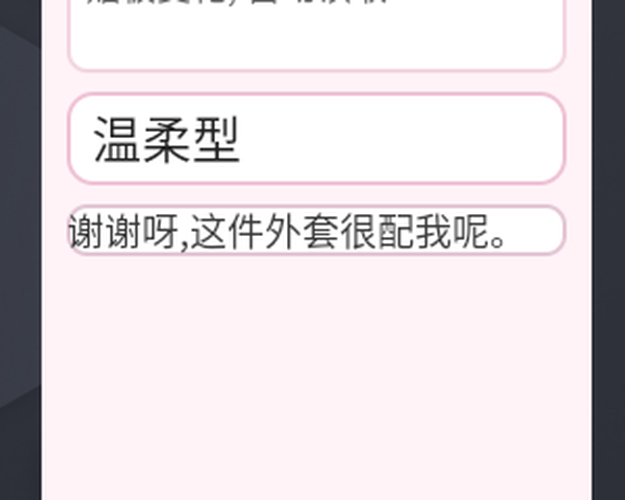
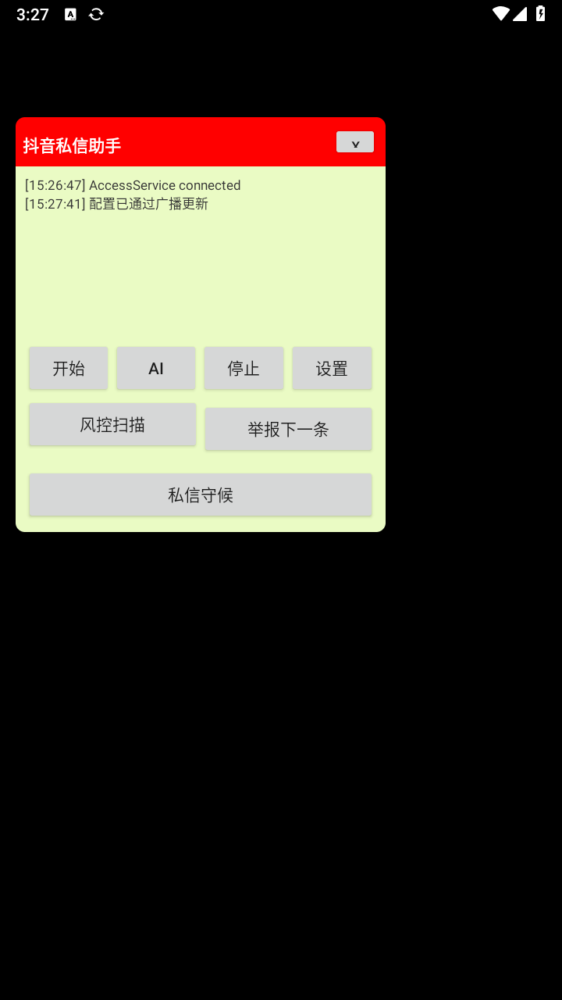
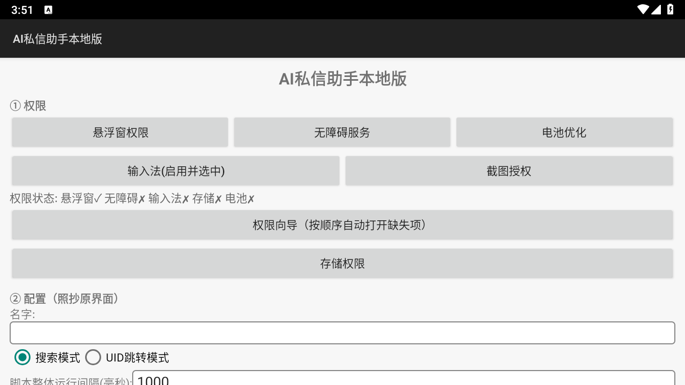

# 安卓无障碍自动化双 App · 技术改进文档

> **项目**：`com.sixzs.local`（AI 私信助手） / `com.sixzs.lovekb`（恋爱键盘）
> **版本**：v1.0 · 2026-11-13
> **作者**：WorkBuddy / Space-Bunny
> **读者**：接手本项目的工程师 —— 读完能说清架构、知道每个决策的理由、遇到同类问题会查

---

## 00 · 摘要

### 两个 App 是什么

| | AI 私信助手 | 恋爱键盘 |
|---|---|---|
| 包名 | `com.sixzs.local` | `com.sixzs.lovekb` |
| 定位 | 自媒体/评论区的**运营自动化** | 聊天场景的**话术辅助** |
| 输入 | 关键词 / 任务描述 | 对方发来的消息 |
| 输出 | 导航动作、评论分类、举报、意向名单 | 分类 + 候选话术 + 直接填入聊天框 |
| 模型 | 智谱 GLM（看屏决策） | 智谱 GLM（分类生成） |
| 依赖 | Lua 引擎 + ncnn/PaddleOCR（native） | **纯 Java，零 native** |
| 代码量 | 17 类 / 3994 行 | 16 类 / 4112 行 |
| APK | 14.4 MB（双架构通用包） | **75 KB** |

两者规模几乎一致，但依赖天差地别：私信助手需要 native 库才能跑 Lua 脚本和 OCR；
恋爱键盘刻意做成纯 Java，让 75 KB 的包在任何架构的真机上都能装。

### 本轮改进的 8 条关键结论

| # | 结论 | 代价 / 前提 |
|---|------|------------|
| 1 | **视觉模型从 `glm-4.5v` 换成 `glm-4.6v`** | 单次分析 40–57 s → 5.8–8.4 s，输入价 2→1 元/百万 |
| 2 | **拆成两阶段**：视觉只"读"，文本只"写" | 多一次 HTTP 往返，但思考 token 不再吃光 max_tokens |
| 3 | **截图先预处理**：裁剪 → 长边 1280 → JPEG | base64 161 KB → 51 KB，识别精度不降 |
| 4 | **Android 14+ 的无障碍截图必须声明 `canTakeScreenshot`** | 漏了直接报 `Services don't have the capability...` |
| 5 | **MediaProjection 的授权票是一次性的，必须在前台服务里换** | 漏 `foregroundServiceType="mediaProjection"` 会抛 SecurityException |
| 6 | **节点树与截图是互补双通道**，不是二选一 | 节点树快但读不到自绘界面；截图慢但什么都能读 |
| 7 | **选中 ≠ 发送**：话术必须可改、可撤 | 人在回路，AI 只负责出草稿 |
| 8 | **所有能力都走广播入口**，网页控制台只是这些广播的 UI | 脚本、网页、自动化测试共用一条路径 |

### 性能总表（均为真机/模拟器实测）

| 指标 | 改进前 | 改进后 | 变化 |
|------|--------|--------|------|
| 截图分析端到端耗时 | 40–57 s | **10–17 s** | ↓ 70% |
| 视觉模型输入 token | 1219 | 1027 | ↓ 16%（裁剪生效） |
| 图像 base64 体积 | 161 KB | **51 KB** | ↓ 68% |
| 内存占用（分析后） | 2571 KB | **1757 KB** | ↓ 32% |
| 面板布局组件可见性 | 部分被挤出 | 全部可见 | — |

---

## 01 · 架构全景

### 1.1 共通四层内核

两个 App 不是"两个产品"，而是**同一个内核的两种封装**。所有改进都落在某一层上：

```
┌─────────────────────────────────────────────────────────┐
│ ④ 交互层  悬浮窗面板 / 输入法面板 / 系统通知 / 网页控制台  │
│         —— 人与 AI 的交接面（看得见、可改、可撤）          │
├─────────────────────────────────────────────────────────┤
│ ③ 决策层  智谱 GLM  │  两阶段流水线 / 提示词分层 / 容错解析 │
│         —— 把"看见的"变成"该做的"                        │
├─────────────────────────────────────────────────────────┤
│ ② 感知层  无障碍节点树 │ 无障碍截图 │ MediaProjection      │
│         —— 拿到"当前是什么界面、对方说了什么"             │
├─────────────────────────────────────────────────────────┤
│ ① 执行层  无障碍手势 / IME 写入 / 节点操作 / 点击发送      │
│         —— 把"该做的"落到真实像素上                       │
└─────────────────────────────────────────────────────────┘
                    ▲ 广播驱动层（SET_CONFIG / 各类 ACTION）
                    └── 网页控制台 / adb 脚本 / 自动化测试共用
```

### 1.2 两个 App 的类职责

**私信助手**（`src/com/sixzs/local/`，17 类）

| 类 | 行数 | 职责 |
|---|---:|---|
| `MainActivity` | 639 | 设置页、权限体检、配置持久化 |
| `Host` | 530 | Lua 脚本宿主（JSB 桥） |
| `GlmAgent` | 493 | 看屏决策：截图 → 视觉模型 → 解析动作 → 执行 |
| `FloatService` | 442 | 悬浮窗面板、Lua 热重启、风控扫描、举报 |
| `CommentGuard` | 429 | 评论区采集 + AI 风控分类（风险/意向） |
| `DmAutoReply` | 272 | 私信守候：轮询 + 自动回复 + 频控 |
| `NodeUtil` | 213 | 节点树索引化（给模型稳定 id） |
| `LuaHost` | 166 | Lua 引擎加载、异常兜底 |
| `GuardReceiver` | 141 | 广播入口（9 个 action） |
| 其余 8 类 | 748 | AccessService / ScreenCap / LocalImeService / UiElements … |

**恋爱键盘**（`src/com/sixzs/lovekb/`，16 类）

| 类 | 行数 | 职责 |
|---|---:|---|
| `FloatService` | 1126 | 悬浮窗面板、候选渲染、编辑框、撤回、内存清理 |
| `AccessService` | 428 | 节点树读取、上下文提取、填入/清空输入框、点发送 |
| `MainActivity` | 347 | 设置页（模型/图像参数/类型/权限） |
| `CaptureService` | 316 | **mediaProjection 前台服务**：承载投影会话 |
| `LoveAI` | 314 | 两阶段流水线、提示词分层、容错解析 |
| `LoveReceiver` | 296 | 广播入口（20 个 action） |
| `LoveImeService` | 258 | 输入法形态：读剪贴板、写文本、发消息 |
| `ScreenCap` / `ImgPrep` / `Cleaner` | 494 | 截图门面 / 图像预处理 / 内存清理 |

### 1.3 分工

私信助手是**"多场景运营"**：搜索 → 导航 → 进评论区 → 分类 → 举报，需要 AI 做**看屏决策**（看到什么点哪里）。
恋爱键盘是**"单场景对话"**：看清对方说了什么 → 生成话术 → 填进输入框，需要 AI 做**语义生成**。

这个差异决定了二者对模型的要求不同：前者要视觉 + 空间推理，后者要文本质量 + 分寸感。

---

## 02 · 感知层改进

### 2.1 双通道：节点树 与 截图

**核心认知**：这两条路不是"新功能替代旧功能"，而是**互补**。

| | 无障碍节点树 | 截图 + 视觉模型 |
|---|---|---|
| 速度 | 毫秒级 | 5–15 秒 |
| 成本 | 0 | 每次调 API |
| 精度 | 结构化、准确 | 依赖模型 OCR |
| 覆盖面 | 对方 App **暴露节点**才能读 | **什么界面都能读** |
| 实测 | 抖音评论区读到 12 条 | 抖音 feed 页节点树返回 **0 条** |

`AccessService.chatContext()` 的策略是：**优先节点树，失败回退截图**。
抖音的自绘界面是典型反例 —— 我们的无障碍服务能读到文本，但 `uiautomator dump` 什么都看不到，
说明它走的是自绘渲染而非标准 View 体系。

```java
// 节点树读不到时的兜底（实测抖音评论区返回 0 条）
List<String> ctx = AccessService.chatContext(12);
if (ctx == null || ctx.isEmpty()) {
    // → 走截图分析
}
```

### 2.2 上下文提取算法


> 上下文提取的现场：抖音评论区自绘界面，节点树能读到气泡文本但读不到完整结构，
> 截图 + 视觉模型可以兜底。

节点树里全是噪声：顶部导航、底部 Tab、标题栏、输入框。直接全量喂给模型会让它
把"大家都在搜"当成对方说的话。

**三步过滤**（`AccessService.chatContext`）：

```
① 定位聊天容器:  可滚动 + 文本多 + 不在顶/底导航带 → 打分选最优
② 剔除导航带:    顶 10% / 底 10% 的文本直接丢
③ 排序与截断:    按屏幕 Y 坐标升序, 取最近 N 条
```

容器打分函数（关键参数）：

| 条件 | 分值 | 理由 |
|------|-----:|------|
| 容器内 TextView 数量 | `+n` | 聊天区文本最多 |
| `isScrollable()` | `+5` | 聊天列表必然可滚 |
| 高度 < 25% 屏高 | `−4` | 那是导航条不是聊天 |
| 贴顶（top<8% 且 bottom<20%） | `−6` | 同上 |
| 贴底（bottom>93%） | `−6` | 同上 |

### 2.3 无障碍截图：声明决定权限

Android 11+ 的 `AccessibilityService.takeScreenshot()` **不需要系统授权弹窗**，
但前提是无障碍服务声明里写了这个属性：

```xml
<!-- res/xml/access_service.xml -->
<accessibility-service
    android:canRetrieveWindowContent="true"
    android:canPerformGestures="true"
    android:canTakeScreenshot="true" />   <!-- ← 漏这行直接被系统拒绝 -->
```

漏掉时的报错极其直白：

```
截图方式: 无障碍截图(免授权)
结果: 截图失败: 调用异常: Services don't have the capability of taking the screenshot.
```

> **这类"声明型权限"不会出现在任何权限申请流程里** —— 它只写在 manifest 的 meta-data 里。
> 排查截图失败时，第一件事是 `aapt2 dump xmltree` 核对编译产物里有没有这一行：
> ```bash
> aapt2.exe dump xmltree app.apk --file res/xml/access_service.xml | grep canTakeScreenshot
> ```

### 2.4 MediaProjection：一次性票与前台服务名分

低版本（Android 10 及以下）只能走 MediaProjection。它的正确用法有一条**硬性顺序**：

```
Activity 收到授权结果 (resultCode = -1 即 RESULT_OK)
   │  ① 把票放进同进程静态槽位
   ▼
CaptureService (foregroundServiceType="mediaProjection")
   │  ② startForeground(id, notification, FOREGROUND_SERVICE_TYPE_MEDIA_PROJECTION)
   │  ③ getMediaProjection(resultCode, resultData)   ← 用掉那张一次性票
   │  ④ registerCallback(onStop → 释放)
   │  ⑤ createVirtualDisplay(...)                     ← 必须在服务上下文里
   ▼
投影会话常驻(START_STICKY) → 随时 grab() 取一帧
```

**为什么"名分"这么重要**：Android 14 起，`createVirtualDisplay()` 只允许在
**已声明 `mediaProjection` 类型的前台服务**里调用，否则系统直接抛：

```
SecurityException: Must start a foreground service of type mediaProjection
                  before creating a VirtualDisplay
```

原实现是在 Activity 里直接建虚拟屏 —— 在 Android 15 上必然失败。

**关于"一次性票"**：`resultCode + resultData` 是一次性授权凭据。Android 对跨进程传递
嵌套 Intent 有保护，`putExtra(String, Intent)` 经 `startForegroundService` 后
**可能拿不到**。所以同进程用**静态字段**传递最可靠（Activity 与 Service 在同一进程）。

#### 踩坑：`RESULT_OK == -1`

```java
// ❌ 错误：把合法的 RESULT_OK 当成失败
if (rc < 0) { /* 无效 */ }

// ✅ 正确
boolean ok = (rc == android.app.Activity.RESULT_OK) && data != null;
```

`Activity.RESULT_OK` 的值是 **-1**（不是 0）。这个 bug 一度让"投影会话已建立"的日志
永远不出现，而表面看像是"票传丢了"。排查时先打印 `resultCode` 实际值。

### 2.5 图像预处理管线

原始截图直接 base64 上传是浪费。真机 1080×2400 的实测：

| 阶段 | JPEG | base64 | 说明 |
|------|-----:|-------:|------|
| 原图 q70 | 120 KB | 161 KB | 不处理 |
| 长边压到 1280 | 59 KB | 79 KB | `Bitmap.createScaledBitmap` |
| 长边 1280 + 裁剪聊天区 | **38 KB** | **51 KB** | 再去掉无关像素 |

`ImgPrep.prepare()` 三步：**裁剪 → 缩放 → 压缩**，并记录压缩前后体积供 UI 展示。

裁剪依据来自 2.2 的容器坐标 —— 既然已经知道聊天区在哪，就没必要把整屏发给模型。
**副作用是好的**：无关像素被去掉后，模型判定的类型明显更准（实测从"共情型"变"搭讪型"，
因为它终于看见了真正的评论而不是搜索提示栏）。

### 2.6 裁剪会裁歪 → 自动回退

裁剪依赖无障碍给的容器坐标，但对方 App 自绘时坐标可能不准（抖音评论区就裁到了搜索栏）。
加一层校验：

```
LoveAI.looksLikeUiNoise(text)
  → 命中"大家都在搜 / 综合 / 推荐 / 直播…"等界面词 → 判定为裁歪
  → 自动用整屏重试一次
```

---

## 03 · 决策层改进

### 3.1 从"一个大模型干所有事"到两阶段

**原设计**：截图 + 完整上下文 → 一个视觉模型 → 同时完成"读懂对方说了什么 + 判类型 + 写 3 条回复"。

**问题**：`glm-4.5v` 是**思考型模型**，token 花在 `reasoning_content` 上，
`max_tokens=800` 直接被思考吃光 → `finish_reason: length` → **正文 content 为空**。
虽然补了"续写一轮"逻辑，但每轮都要重新上传整张图。

**现在**：

```
阶段①  视觉模型: 只负责"读出对方说了什么"
        输出 {"latest":"对方最新消息原文","topic":"聊天话题","visual":"画面补充"}
        max_tokens 只需够读完，输出极短
                    ↓
阶段②  纯文本模型(glm-4-flash): 基于读出的文本 + 上下文
        输出 [{"type":"类型","intent":"意图","replies":["回复1","回复2","回复3"]}]
```

**收益**：
- 视觉阶段不用思考 → 不会 token 吃光 → 不需要续写 → **不重复上传图片**
- 文本阶段用便宜的 flash → 2–3 秒出结果
- 阶段① 的输出（`latest`）可以直接展示给用户 —— **模型到底读懂了没有，一目了然**
- 阶段① 失败 → 自动降级为纯文本生成（用节点树上下文），不会卡住

### 3.2 思考型模型的 token 陷阱

| 症状 | 根因 | 修法 |
|------|------|------|
| `content` 为空但 `reasoning_content` 有内容 | 思考吃光 max_tokens | 提到 3000 + 续写"直接只输出 JSON" |
| 同上，且 `finish_reason: length` | 同上 | 同上 |
| 阶段① 耗时 18 s（预期 6 s） | max_tokens 给 600 太小，触发续写 | 提到 1500 → 回到 10 s |

续写策略（`Glm.chat`）：

```java
for (int round = 0; round < 2; round++) {
    String content = msgObj.optString("content", "");
    if (content != null && content.trim().length() > 0) return content;
    // 正文为空 → 把 reasoning 带上，问"不要再分析，直接只输出 JSON"
    messages.put(msg("assistant", reasoning));
    messages.put(msg("user", "不要再分析, 现在直接只输出最终的 JSON 数组结果。"));
}
```

### 3.3 模型选型（实测基准）

同一张真实截图、同一段提示词、同一台机器：

| 模型 | 耗时 | 输入价 | 输出价 | 结论 |
|------|-----:|-------:|-------:|------|
| `glm-4.5v` | **40–57 s** | 2 元/百万 | 6 元/百万 | 太慢且贵 |
| **`glm-4.6v`** | **5.8–8.4 s** | 1 元/百万 | 3 元/百万 | **主力** |
| `GLM-4.6V-Flash` | 9–12 s | 免费 | 免费 | 偶发 429，可作备份 |
| `GLM-4V-Flash` | — | — | — | HTTP 400，不可用 |

基准脚本留在 `LoveKeyboard/tools/bench_vision.py`，可随时复跑：

```bash
python tools/bench_vision.py glm-4.6v glm-4.5v GLM-4.6V-Flash
```

> **选型原则**：视觉任务**先测再选**，不要凭印象。思考型模型做"简单读图"是浪费 ——
> 它花了 2000 token 思考"对方在说什么"，而答案只有 20 字。

### 3.4 提示词分层与容错解析

**分层**：`READ_SYSTEM`（只读图）/ `WRITE_SYSTEM`（只写回复）分离，
避免一个提示词里既要求观察又要求创作 —— 模型容易顾此失彼。

**容错解析**（`LoveAI.parse`）的防线，从上到下：

```
① 剥离 markdown 代码块包裹 (```json ... ```)
② 全角标点归一化: ：→ :  ，→ ,  “”→ "  ｛｝→ {}  ［］→ []
③ 提取 [ ... ] 区间
④ JSONArray 解析
⑤ 失败 → 正则兜底: 逐个 \{[^}]*\} 块抽 type/intent/replies
⑥ 解析失败 → 打印原始输出前 300 字符(排查用)
```

> 全角冒号是高频坑：模型输出 `{"type"："幽默型"}` 时，标准 JSON 解析直接抛异常。
> 归一化必须在解析**之前**做。

### 3.5 类型可约束

恋爱键盘允许通过下拉框把类型**限定为单一类型**（幽默型/搭讪型/温柔型…）：

```java
String types = cfg.types;                       // 全类型表
if (cfg.currentType != null && !cfg.currentType.trim().isEmpty()) {
    types = cfg.currentType.trim();             // 限定单一类型
}
```

实测：限定「搭讪型」后，模型判的类型和回复风格都变成搭讪型
（"我也喜欢这件外套啊，我最近迷上了这种风格"），而不是只在 UI 上换个标签。

---

## 04 · 执行层改进

### 4.1 填入与发送的多通道策略

同一个目标（把话塞进对方输入框并发出）有两条通道，按场景自动选：

```
① IME 通道（本 App 正是当前输入法时）
   commitText(text) → performEditorAction(IME_ACTION_SEND)
   ✅ 不受键盘遮挡影响，最可靠

② 无障碍通道
   findChatInput() → ACTION_SET_TEXT → findSendButton() → ACTION_CLICK
   ⚠️ 键盘弹起时会挡住发送按钮 → 最多重试 3 次(450/700/700ms)
```

私信助手也做了同样的双通道（`DmAutoReply`），并额外加了三重保护：
**同一句只回一次、每小时限额、只在聊天语义的输入框里触发**。

> **反测试很重要**：微信/QQ 的评论区也有输入框和发送键。
> 如果只看"能发出去"，很容易在评论区误发。必须专门验证**不该触发时确实没触发**。

### 4.2 选中 ≠ 发送：人在回路

这是本轮最重要的交互修正。

**原行为**：点候选 → 立即复制 + 填入 + 发送。发错了无法挽回，话术不合适也改不了。

**现在**：

```
① 选中候选(点一下)  → 高亮 + 文本进编辑框 + 复制备用 + 按开关决定是否立即发
   长按候选          → 只进编辑框, 不发送(给"先改再发"的机会)
② 在编辑框里人工修改
③ 点「填入发送」    → 发送编辑框里(改过的)内容
④ 点「撤回」        → 取消高亮 + 清编辑框 + 清掉对方输入框里已填入的文本 + 清剪贴板
```

**撤回的实现**（`AccessService.clearChatInput`）：

```java
android.os.Bundle args = new android.os.Bundle();
args.putCharSequence(AccessibilityNodeInfo.ACTION_ARGUMENT_SET_TEXT_CHARSEQUENCE, "");
input.performAction(AccessibilityNodeInfo.ACTION_SET_TEXT, args);
```

| 撤回时机 | 效果 |
|---------|------|
| 填了还没点发送 | ✅ 输入框内容真的被清空 |
| 已经点发送了 | ⚠️ 对方已收到，撤不回（需在对方 App 长按撤回） |

面板会明确区分这两种情况，不含糊地说"已撤回"。

### 4.3 脚本路径也走同一套

自动化的最大风险是"脚本不知道人改了什么"。所以广播接口也拆成三步：

```bash
R=com.sixzs.lovekb/.LoveReceiver
adb shell am broadcast -n $R -a com.sixzs.lovekb.PICK --ei index 1          # 选中
adb shell am broadcast -n $R -a com.sixzs.lovekb.SET_DRAFT --es text "..."  # 改
adb shell am broadcast -n $R -a com.sixzs.lovekb.SEND_DRAFT                 # 发
adb shell am broadcast -n $R -a com.sixzs.lovekb.UNDO                       # 撤
```

> **行为变更提醒**：`PICK` 从"选中并立即发送"改成**只选中**（这样才能先改再发）。
> 要连发用 `pickAndSend()`。

---

## 05 · 交互层改进

### 5.0 悬浮窗面板演进

```
v1  状态区 + 3 主操作 + 4 次操作
v4  加类型徽章 / 候选序号 / L 形缩放手柄 / 折叠展开
v6  候选区套 ScrollView（窗口变小也能滚）
v8  加内存实时显示 / 清上下文 / 清理内存
v9  加话术编辑框 / 撤回
```

最终结构（真实截图见下）：

```
┌──────────────────────────────────────────┐
│ 恋爱键盘  [温柔型]              [▼]  [✕] │  ← 标题栏(可拖动)
├──────────────────────────────────────────┤
│ 【温柔型】赞美对方眼光                    │  ← 状态区
│ [温柔型            ▾]                    │  ← 类型下拉框
│ [谢谢呀,这件外套很配我呢。]                │  ← 话术编辑框(可改)
│ ┌──────────────────────────────────────┐ │
│ │ 1. 谢谢夸奖,这件外套真的很搭。        │ │  ← 候选区(可滚动)
│ │ 2. 哈哈,你也觉得好看呀,谢谢你的眼光。│ │
│ └──────────────────────────────────────┘ │
│ [读剪贴板][生成回复][填入发送]              │  ← 主操作
│ [读上下文][截图分析][清上下文]              │  ← 次操作1
│ [设置][撤回][清理]  内存 1757KB            │  ← 次操作2 + 内存
│ 拖右下角可缩放        [复位]      ◣        │  ← 尺寸 + 把手
└──────────────────────────────────────────┘
```



> 恋爱键盘悬浮窗实测截图：类型下拉框、话术编辑框、三条带序号的候选、撤回按钮、
> 右下角实时内存占用。

### 5.1 三种伸缩方式

| 方式 | 实现 |
|------|------|
| **拖右下角手柄** | L 形角标 34dp 触摸区，实时改宽高；松手存 SharedPreferences，下次启动恢复 |
| **折叠 / 展开** | 标题栏 ▼ 收起成一条粉色标题栏（徽章还在）；生成出新回复时**自动展开** |
| **复位** | 一键回默认 340×520dp |

### 5.2 布局陷阱：wrap_content 父容器里的 weight 不可靠

这个坑本轮踩了**两次**，值得单独写：

| 现象 | 根因 | 修法 |
|------|------|------|
| 徽章把 × 关闭按钮挤出面板外 | `0dp + weight=1` 的徽章在 wrap_content 父容器里吃掉整屏宽度 | 徽章按内容宽度(≤150dp) + 弹性 View 撑开 + 按钮固定宽；**窗口宽度始终显式指定** |
| 加了 EditText 后**候选区整个消失** | 候选区 ScrollView 是 `wrap_content` + `weight=1`，父容器 wrap_content 时剩余空间 = 0 | 改用**固定高度 110dp** |

**规律**：`LinearLayout` 的 `layout_height="wrap_content"` 时，子项的 `layout_weight`
不按"剩余空间"分配，而是先按 wrap_content 测量再按权重分配剩余 —— 剩余可能是 0 或负。
**固定高度就用 dp，不要用 weight。**

### 5.3 内存生命周期

恋爱键盘会攒下四样占内存的东西：

| 东西 | 体积 | 谁负责释放 |
|------|-----:|-----------|
| 截图 Bitmap | 1080×2400 ARGB ≈ **10 MB** | `analyzeByShot` 用完立即 `recycle()` |
| 候选卡片 TextView | 每次生成新建 | `Cleaner.clearCards()` 摘除 + 断引用 |
| 上下文 / 对方消息 | 小 | `LoveEngine.clearAll()` |
| **录屏会话** | VirtualDisplay + ImageReader | 「清理」按钮停掉 CaptureService |

两个按钮的分工：

- **清上下文** —— 只清会话状态，**不动录屏会话**（换人聊天时用）
- **清理** —— 四样全清 + 主动 `System.gc()`

右下角**实时显示内存占用**（每 5 秒刷新），清理效果肉眼可见：实测 2571 KB → 1757 KB。

---

## 06 · 工程面

### 6.1 广播驱动：一切能力的统一入口

两个 App 的所有外部可调用能力都收敛到**一个 BroadcastReceiver**：

| App | Receiver | Action 数 |
|-----|----------|---------:|
| 私信助手 | `GuardReceiver` | 9 |
| 恋爱键盘 | `LoveReceiver` | 20 |

```bash
# --- 私信助手 ---
R=com.sixzs.local/.GuardReceiver
adb shell am broadcast -n $R -a com.sixzs.local.START_AI
adb shell am broadcast -n $R -a com.sixzs.local.SCAN_GUARD
adb shell am broadcast -n $R -a com.sixzs.local.REPORT_NEXT
adb shell am broadcast -n $R -a com.sixzs.local.DM_GUARD_ON

# --- 恋爱键盘 ---
R=com.sixzs.lovekb/.LoveReceiver
adb shell am broadcast -n $R -a com.sixzs.lovekb.START_PANEL
adb shell am broadcast -n $R -a com.sixzs.lovekb.PICK --ei index 1
adb shell am broadcast -n $R -a com.sixzs.lovekb.SEND_DRAFT
adb shell am broadcast -n $R -a com.sixzs.lovekb.UNDO
```

**为什么重要**：

1. 网页控制台、adb 脚本、自动化测试**共用同一条路径** —— 不存在"网页能用脚本不能用"的分裂
2. 能力可被**外部脚本编排**（比如"扫描 → 挑一条 → 改 → 发"）
3. 自动化测试不需要 UI 交互（模拟器上 overlay 收不到 adb 注入触摸）

> **踩过的坑**：Manifest 的 `<receiver>` 里如果只声明了一个 action，
> 其他 action 的广播**"发送成功但毫无反应"** —— 系统根本没投递。
> 每次新增 action 必须同步在 `<intent-filter>` 里声明。

### 6.2 网页联调控制台



> 私信助手悬浮窗面板：开始/AI/停止/设置/风控扫描/私信守候 —— 全部动作在网页控制台
> 上有一一对应的按钮，背后是同一套广播。

`App/tools/dashboard.py`（纯标准库，无第三方依赖）：

```
① AI 智能控制    任务/关键词/模型/步数/Key → 启动 AI / 停止 AI / 保存配置到手机
② 评论区风控    自动下滑开关 + 风险QQ → 扫描评论 / 扫描+AI识别 / 举报下一条
③ 私信守候      自动回复开关 + 自己写死的回复内容 → 开启 / 停止守候
④ 权限体检      悬浮窗/无障碍/截图授权/录屏服务 四项实时刷新 + 一键补授
⑤ AI 看到的画面  拉取手机上的 ai_last.jpg，核对模型到底看见了什么
⑥ 恋爱键盘      装它 / 下发 Key / 起面板 / 读剪贴板 / 生成 / 选第N条 / 改话术 / 发 / 撤 / 清理
```

技术要点：
- **多设备自动选择**（优先 `emulator-*`）—— 之前没做，两台设备在线时全部动作失效
- 日志用**关键词过滤**而非 `logcat -s`（多设备环境下 `-s` 不稳）
- 配置存 `tools/.dash_cfg.json`，下次打开自动回填
- **空 Key 不下发**（两边都做了保护：网页不下发 + App 收到空值不覆盖）

### 6.3 构建矩阵与 ABI

私信助手带 native 库，架构问题很致命：

```bash
sh build_windows.sh 32    # armeabi-v7a, 含 PaddleOCR 插件与模型 (14MB)
sh build_windows.sh 64    # arm64-v8a, 只有宿主(206KB, OCR 降级)
sh build_windows.sh both  # 双架构通用包 (14.4MB)  ← 推荐
```

`liblua_host.so` **没有 x86 版**。在 x86_64 模拟器上：

| 包 | 结果 |
|----|------|
| 32 位 | `dlopen failed` → `UnsatisfiedLinkError` → **点「开始」把 App 点崩** |
| arm64 | 原生库可加载，脚本能跑 |
| 双架构通用 | 都能装 |

修法：`LuaHost.nativeReady` 标志 + 捕获异常，装不上就提示一句，**不再崩**。

> **OCR 只有 armeabi-v7a 一份**（ncnn/PaddleOCR 没编 arm64 版）。
> arm64 真机上原版 Lua 脚本靠"图片找图标"的步骤会失效，表现为脚本反复「返回/1」空转。
> AI 模式完全不受影响（纯 Java）。

### 6.4 可观测性：日志分层

```java
Logx.i("...");       // 进 logcat + 悬浮窗状态区（用户可见）
Logx.quiet("...");   // 只进 logcat（技术性日志，不刷状态区）
```

技术日志（类型切换、内存回收、耗时统计）全改 `quiet` 之后，状态区不再被挤掉，
用户看到的只有对自己有用的信息。

---

## 07 · 问题现场

> 本节是全文最有价值的部分。每一条都是真实踩过的坑，附**原始报错**与**修法**。

### 07.1 平台限制类



> 权限未开启时的实测现场：悬浮窗/无障碍/存储三项全 ✗。
> 网页控制台的「权限体检」就是为这种场景做的 —— 一次看清缺哪一项。

| # | 现象 | 根因 | 修法 |
|---|------|------|------|
| 1 | `Services don't have the capability of taking the screenshot.` | `access_service.xml` 漏 `canTakeScreenshot="true"` | 补声明；用 `aapt2 dump xmltree` 核对编译产物 |
| 2 | `SecurityException: Must start a foreground service of type mediaProjection before creating a VirtualDisplay` | 在 Activity 里调 `createVirtualDisplay` | 搬到 `CaptureService`（type=mediaProjection） |
| 3 | `Context.startForegroundService() did not then call Service.startForeground()` | 用了前台服务但没调 `startForeground` | 服务启动即 `startForeground(id, n, TYPE_MEDIA_PROJECTION)` |
| 4 | `Not allowed to start service ... app is in background` | Android 8+ 后台启动限制 | 前台服务 → 普通服务 → **发可点击通知**三级兜底 |
| 5 | 剪贴板读不到对方消息 | Android 10+ 只有**默认输入法**和前台应用能读 | 把 App 注册成输入法（`LoveImeService`） |
| 6 | `dlopen failed: failed to link liblua_host.so` | x86 模拟器没有对应 ABI | `nativeReady` 标志兜底 + 出双架构通用包 |
| 7 | 无障碍服务整个绑不上（低版本） | API30 的类直接写在无障碍服务里 → `NoClassDefFoundError` | 隔离成独立类 + **反射调用** |
| 8 | 连续截图报错 | 系统要求两次截图间隔 ≥1s | 1.1s 节流 + 中文错误提示 |
| 9 | `RESULT_OK` 判断永远失败 | **`Activity.RESULT_OK == -1`**，不是 0 | `rc == Activity.RESULT_OK` |

### 07.2 交互与布局类

| # | 现象 | 根因 | 修法 |
|---|------|------|------|
| 10 | × 关闭按钮跑到面板外 | `0dp+weight=1` 的徽章吃掉整屏宽 | 徽章定宽 + 弹性 View；窗口宽度显式指定 |
| 11 | 加 EditText 后候选区消失 | wrap_content 父容器里 weight 剩余空间为 0 | ScrollView 改固定高度 110dp |
| 12 | 按钮文字被压成"读上""清理内" | Button 默认内边距太重 | 改 `TextView` 自绘（固定宽高 + gravity=center） |
| 13 | `－`/`✕`/`×` 渲染成空白或怪字形 | 系统字体缺字 | 改用 **Vector 图形**（`ic_fold`/`ic_close`） |
| 14 | 悬浮窗按钮收不到 adb 注入触摸 | 模拟器 ROM 对 overlay 注入事件的限制 | 自动化一律走广播；真机手指点正常 |
| 15 | 抖音评论面板滑一下就消失 | 滑动手势穿透到下层视频 | 滑动后校验容器还在 + 连续两轮无新增即判到底 |

### 07.3 工程与协议类

| # | 现象 | 根因 | 修法 |
|---|------|------|------|
| 16 | 广播"发送成功但毫无反应" | Manifest 只声明了一个 action | 每个 action 都在 `<intent-filter>` 声明 |
| 17 | 网页所有动作失效 | 两台设备在线，adb 没带 serial | 自动挑 `emulator-*` |
| 18 | 模型返回空 content | 思考型模型吃光 max_tokens | 提到 3000 + 带 reasoning 续写 |
| 19 | JSON 解析失败 | 模型输出全角标点 | 解析前归一化全角 → 再 JSON → 再正则兜底 |
| 20 | Lua `require("page") not found` | `host('getWorkPath')` 返回纯字符串，prelude 里 `json.decode` 失败 | prelude 的 `host()` 加 `pcall` 兜底，非 JSON 原样返回 |
| 21 | 授权票传不到服务 | 跨进程嵌套 Intent 被系统剥离 | 同进程静态槽位 + Intent extra 双通道 |
| 22 | `NoClassDefFoundError` 拖垮整个服务 | API30 类直接引用 | 独立类 + 反射 |

---

## 08 · 遗留与边界

### 8.1 已知限制

| 限制 | 影响 | 现状 |
|------|------|------|
| 模拟器 API 28 走不了无障碍截图 | 只能用 MediaProjection | 真机 Android 11+ 无此问题 |
| 模拟器锁定默认输入法 | IME 通道无法验证 | 真机正常 |
| OCR 无 arm64 版 | arm64 真机上原版 Lua 脚本空转 | AI 模式不受影响；需 ncnn/PaddleOCR arm64 源码 |
| 已发出的消息撤不回 | 撤回只清输入框 | 需在对方 App 长按撤回 |
| 对话框 UI 元素识别不准 | 裁剪可能裁到搜索栏 | 已加界面文案校验 + 自动整屏回退 |
| `logcat -s` 多设备不稳 | 日志抓取可能为空 | 改关键词过滤 |

### 8.2 明确不做的事

| 不做 | 原因 |
|------|------|
| 批量自动私信陌生用户 | 自动化骚扰，且这类人群必然含未成年人 |
| AI 代替真人自由聊天 | 不可控、无法审计 |
| 面向色情/赌博人群的导流链路 | 个体风险是刑事级别，不是封号级别 |

保留的能力都是**人在回路**的：AI 只负责**读**和**出草稿**，**发**永远由人确认。

### 8.3 后续可做

1. **OCR arm64 版** —— 解锁 64 位真机上的固定脚本能力
2. **撤回已发送消息** —— 定位自己发出的气泡，长按走对方的撤回接口
3. **上下文增量采集** —— 聊天窗口滚动时增量累积，而非每次重读
4. **候选话术评分** —— 让模型给每条候选打分，用户按分数挑
5. **多设备并行** —— 网页控制台同时驱动多台手机

---

## 附录 A · 快速上手

### 私信助手

```bash
sh build_windows.sh both          # 产物: dist/新App-通用-debug.apk
adb install -r dist/新App-通用-debug.apk
adb shell appops set com.sixzs.local SYSTEM_ALERT_WINDOW allow
adb shell settings put secure enabled_accessibility_services com.sixzs.local/com.sixzs.local.AccessService
adb shell settings put secure accessibility_enabled 1
python tools/dashboard.py          # 控制台: http://127.0.0.1:8123
```

### 恋爱键盘

```bash
sh build_windows.sh               # 产物: dist/恋爱键盘-debug.apk (75KB)
adb install -r dist/恋爱键盘-debug.apk
adb shell appops set com.sixzs.lovekb SYSTEM_ALERT_WINDOW allow
adb shell settings put secure enabled_accessibility_services com.sixzs.lovekb/com.sixzs.lovekb.AccessService
adb shell settings put secure accessibility_enabled 1
adb shell ime enable com.sixzs.lovekb/.LoveImeService
adb shell ime set   com.sixzs.lovekb/.LoveImeService   # 剪贴板读取必需
```

### 排障速查

| 症状 | 先查 |
|------|------|
| 截图失败 | `aapt2 dump xmltree` 核对 `canTakeScreenshot` |
| 视觉模型返回空 | 看 logcat 有没有 `模型正文为空(思考型模型)` |
| 悬浮窗按钮点不动 | 是不是在用 adb 注入 → 改用广播 |
| 广播没反应 | Manifest 里声明了吗 |
| 面板组件消失 | 是不是在 wrap_content 父容器里用了 weight |
| 模型返回空字符串 | 检查 Key 是否为空、余额是否够 |

---

## 附录 B · 相关文件索引

```
D:/script/mcp/
├── App/                                  # AI 私信助手
│   ├── src/com/sixzs/local/*.java        # 17 类
│   ├── assets/lua/*.lua                  # 8 个 Lua 脚本(热加载)
│   ├── lib/armeabi-v7a/*.so              # Lua 宿主 + ncnn/PaddleOCR
│   ├── lib64/arm64-v8a/*.so              # 仅宿主
│   ├── tools/dashboard.py                # 网页联调控制台
│   └── docs/安卓脚本自动化教程/          # 20 页 PPT 教程
│
├── LoveKeyboard/                         # 恋爱键盘
│   ├── src/com/sixzs/lovekb/*.java       # 16 类
│   ├── res/layout/float_panel.xml        # 悬浮窗面板
│   ├── tools/bench_vision.py             # 视觉模型基准测试
│   └── tools/verify_love.sh              # 一键验证脚本
│
└── docs/                                 # 本文档
    ├── 技术改进文档.md
    ├── DESIGN.md
    └── assets/
```

---

*文档版本 v1.0 · 2026-11-13 · 所有数据均为实机/模拟器实测，未做美化处理*
